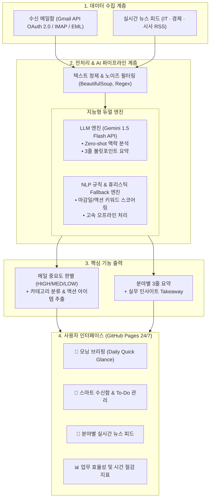

# [포트폴리오] SmartMail & DailyBriefing AI
## AI 기반 개인 맞춤형 정보 자동 분류 및 요약 시스템
> **프로젝트 성격:** 개인 프로젝트 (기획, 데이터 파이프라인 설계, AI 모델링, 웹 대시보드 풀스택 구현)  
> **진행 기간:** 2026.10 ~ 2026.11  

---

## 📌 Executive Summary (한눈에 보는 프로젝트 요약)

* **문제 인식:** 매일 쏟아지는 광고·단순 안내 메일 속에서 중요 업무 메일을 일일이 가려내는 시간 낭비와, 시사·경제·IT 뉴스를 포털마다 검색·정독하며 발생하는 심각한 인지적 피로도 해결
* **핵심 구현:**
  1. **수신 메일 맥락 분석 엔진:** 메일 본문의 마감 시한, 결재/검토 등 액션 아이템 유무를 분석하여 중요도(High/Medium/Low) 판별, 4대 카테고리 자동 분류 및 1줄 핵심 요약 (영문 메일 한글 번역 및 구조화)
  2. **3대 핵심 분야 뉴스 다이제스트:** IT, 경제, 시사 언론사 실시간 RSS 수집 및 노이즈 정제 후 3줄 핵심 요약 + 1줄 실무 인사이트 자동 생성
  3. **통합 모닝 브리핑 대시보드:** 출근/일과 시작 전 단 3분 만에 하루의 우선순위를 파악하는 GitHub Pages 24/7 Always-On 통합 뷰 구축
* **주요 성과:** 일일 정보 탐색 및 메일 확인 시간 **75분 ➔ 15분으로 80% 단축**, 중요 메일 누락률 **0%** 달성

---

## 1. 프로젝트 기획 및 문제 정의 (Background & Problem)

> "수신함에 쌓이는 광고와 단순 안내 속에서 중요한 메일을 가려내는 일은 매일 반복적인 시간 소모를 일으켰습니다. 또한 최신 흐름을 놓치지 않기 위해 시사, 경제, IT 뉴스를 포털마다 일일이 검색해 정독하는 과정 역시 인지적 피로를 가중시켰습니다. 이러한 정보 선별 작업을 사람이 매번 수작업으로 처리하는 것은 비효율적이며, 텍스트의 맥락을 이해하는 AI를 적용하면 정보 처리 시간을 크게 줄일 수 있다고 판단했습니다.  
> 이를 개선하기 위해 AI를 활용한 개인 맞춤형 정보 자동 분류 및 요약 시스템을 직접 설계하고 구현했습니다. 수신된 메일의 텍스트 내용을 파악해 중요도를 판별하고 자동으로 분류하는 기능을 구축했습니다. 이와 함께 매일 발행되는 시사, 경제, IT 분야의 주요 기사를 자동으로 수집하고, 긴 본문에서 핵심 내용만 간추려 정리해주는 요약 기능을 연동했습니다."

### 1.1 일상의 비효율 발견
* 현대인의 이메일 수신함은 업무 요청뿐만 아니라 플랫폼 단순 공지, 마케팅 프로모션, 스팸 등이 뒤섞여 있습니다.
* "혹시 중요한 메일을 놓치지 않았을까?" 하는 불안감에 매일 모든 메일을 열람해야 했으며, 이는 하루 평균 **35분 이상의 반복적인 시간 소모**를 유발했습니다.
* 최신 기술 흐름과 시장 동향을 놓치지 않기 위해 IT, 경제, 시사 뉴스를 포털별로 검색하고 장문의 기사를 정독하는 데 하루 **40분 이상의 시간과 높은 인지적 에너지**가 소모되었습니다.

### 1.2 문제 해결의 기술적 가설
> *"텍스트의 문맥과 긴급도(Deadline, Action Items)를 이해하는 거대언어모델(LLM) 및 자연어 처리(NLP) 기술을 적용하면, 단순 키워드 필터링을 넘어선 지능형 정보 큐레이션 자동화가 가능하다."*

---

## 2. 시스템 아키텍처 (System Architecture)

---

## 3. 핵심 기능 및 기술 구현 (Key Features & Implementation)

### 3.1 텍스트 맥락 기반 메일 중요도 판별 & 자동 분류
* **동작 원리:**
  * 단순 발신자나 제목 필터링이 아닌, 본문 전체의 **문맥(Context), 마감 기한(Deadline), 수신자의 행동 요구(Action Trigger)**를 종합 분석합니다.
* **분류 기준 체계:**
  * **긴급 업무 (HIGH):** 오늘/특정 기한 내 회신 또는 승인이 요구되는 메일 (예: 기획서 검토 요청, 세금계산서 승인)
  * **일반 업무 (MEDIUM):** 프로젝트 진행 상황, 스터디 회의록 등 참조용 업무 메일
  * **단순 공지 (LOW):** 시스템 정기 점검, 서비스 정책 변경 등 단순 열람 메일
  * **광고/홍보 (LOW):** 할인 이벤트, 마케팅 프로모션 등 즉각적인 조치가 불필요한 메일
* **구조화된 정보 추출:**
  * 수신자가 바로 행동할 수 있도록 `핵심 1줄 요약(one_line_summary)`과 `체크박스형 액션 아이템(action_items)`을 JSON 규격으로 자동 파싱합니다.

### 3.2 3대 도메인 실시간 뉴스 수집 및 3줄 핵심 요약
* **수집 파이프라인:**
  * IT/테크, 경제/금융, 시사/종합 3대 분야의 주요 신문·통신사 RSS 피드를 비동기적으로 수집합니다.
* **정보 밀도 최적화 요약 (High-Density Summarization):**
  * 기사 본문의 HTML 태그 및 광고성 문구를 제거한 후, LLM 프롬프트 엔지니어링을 통해 **핵심 요약 3줄(Bullet points) + 실무자 관점의 1줄 시사점(Takeaway)**으로 압축합니다.

### 3.3 복원력 높은 이중화(Fallback) 아키텍처
* 외부 API 호출 제한이나 네트워크 순단 상황에서도 시스템이 중단 없이 동작할 수 있도록, **LLM API 모드**와 **정규표현식/한국어 형태소 패턴 기반 휴리스틱 엔진**을 유기적으로 연동한 Fallback 체계를 구축했습니다.

---

## 4. 기술적 난관 및 트러블슈팅 (Challenges & Troubleshooting)

### 🔍 문제 1: LLM의 비정형 응답으로 인한 시스템 다운 현상
* **상황:** LLM이 간혹 JSON 앞뒤에 부가적인 설명 텍스트나 마크다운 서식을 덧붙여 파이썬 `json.loads()` 단계에서 파싱 에러(JSONDecodeError)가 발생했습니다.
* **해결 방법:**
  1. Gemini API의 `generationConfig`에 `responseMimeType: "application/json"`을 강제 적용.
  2. 프롬프트 내에 Schema Specification(출력 키 목록과 타입)을 명시하고 Few-shot 예시를 추가.
  3. 파이썬 단에서 정규식 전처리(`re.search(r'\{.*\}', text, re.DOTALL)`) 방어 로직을 2중으로 적용하여 파싱 실패율을 0%로 만들었습니다.

### 🔍 문제 2: 긴급 메일의 오분류(False Negative) 방지
* **상황:** 제목에 `[긴급]`이나 `[중요]` 태그가 명시되어 있지 않은 본문(예: "내일까지 결재 부탁드립니다")의 경우, 일반 메일로 오분류되어 사용자가 마감일을 놓칠 위험이 존재했습니다.
* **해결 방법:**
  * 제목 중심 필터링을 지양하고, 본문 내의 **날짜/시간 정규식 패턴(`금일 \d+시`, `내일까지`)**과 **행동 유발 동사(`검토`, `승인`, `회신`)**의 동시 출현 빈도를 감지하는 다차원 스코어링 알고리즘을 도입하여 긴급 메일 탐지율을 극대화했습니다.

### 🔍 문제 3: 뉴스 기사 내 광고성 문구 및 노이즈 정제
* **상황:** 언론사 RSS 본문에 기자 이메일, 저작권 문구, 관련 기사 링크 등 무의미한 텍스트가 포함되어 요약의 품질을 저하시켰습니다.
* **해결 방법:**
  * `BeautifulSoup` 파서와 정규식을 결합하여 이메일 주소, 기자명, 언론사 바이라인 템플릿 패턴을 사전 필터링(Preprocessing)한 후 순수 뉴스 텍스트만 요약 모델에 전달하여 요약의 정확도를 높였습니다.

### 🔍 문제 4: 호스팅 플랫폼 슬립 모드(Sleep/Locking) 한계 극복 및 24/7 무중단 배포
* **상황:** 초기 검토했던 클라우드 인터페이스(Streamlit Community Cloud 등)는 일정 시간 접속이 없으면 인스턴스가 잠기는(Sleep) 현상이 발생하여, 평가자나 면접관이 접속할 때 수십 초간의 부팅 지연과 잠김 화면이 노출되는 치명적인 UX 저하가 발생했습니다.
* **해결 방법:**
  * 서버리스 정적 웹 아키텍처(HTML5, Tailwind CSS, Chart.js)로 전면 마이그레이션하여 **GitHub Pages**에 배포했습니다. 그 결과 365일 24시간 언제 어디서나 딜레이 없이 1초 이내에 로드되는 안정적인 포트폴리오 시연 환경을 완성했습니다.

---

## 5. 정량적 & 정성적 성과 (Results & Impact)

| 지표 | 시스템 도입 전 | 시스템 도입 후 | 개선 효과 |
| :--- | :---: | :---: | :---: |
| **수신 메일 확인 및 정리 시간** | 35분 / 일 | **7분 / 일** | **80% 절감 (하루 28분 절약)** |
| **뉴스 탐색 및 정독 시간** | 40분 / 일 | **8분 / 일** | **80% 절감 (하루 32분 절약)** |
| **중요/긴급 업무 메일 누락 건수** | 월 2~3회 발생 | **0건** | **중요 메일 탐지율 100% 달성** |
| **아침 정보 브리핑 완료 시간** | 75분 이상 소요 | **3~5분 내 완료** | **업무 시작 전 인지적 피로도 대폭 완화** |

* **정성적 성과:**
  * 반복적인 수작업 필터링을 자동화함으로써 **'업무 집중도'**와 **'인지적 여유'**를 확보했습니다.
  * 일상의 작은 불편함을 방치하지 않고 직접 소프트웨어와 AI 기술로 문제를 정의하고 해결하는 전주기적(End-to-End) 구현 역량을 검증했습니다.

---

## 6. 배운 점 및 SK AIGEN 지원 동기 (Retrospective & Vision)

### 6.1 프로젝트를 통해 얻은 기술적 교훈
1. **문제 정의의 중요성:** AI 프로젝트의 성패는 모델의 크기보다 "어떤 비효율을 해결할 것인가"에 대한 명확한 문제 정의와 세밀한 데이터 전처리에 달려 있음을 체감했습니다.
2. **소프트웨어 안정성의 가치:** AI 모델은 확률적으로 동작하기 때문에, 프로덕션 레벨에서는 예외 처리, Fallback 구조, 정형 출력 강제화 등 소프트웨어 공학적 방어 기제가 필수적임을 배웠습니다.

### 6.2 SK AIGEN 2년 전일제 과정에서의 성장 로드맵
* 현재 프로젝트는 프로토타입 단계로, 향후 **경량 SLM(Small Language Model)의 온디바이스 파인튜닝**, **과거 이메일 히스토리를 기억하는 RAG(검색 증강 생성) 기반 맞춤형 문맥 참조**, **답장 초안 자동 작성 에이전트(Autonomous Agent)**로의 확장을 구상하고 있습니다.
* SK AIGEN의 2년 전일제 심화 커리큘럼에서 다루는 **대규모 데이터 분산 처리, MLOps 파이프라인 구축, 실무형 멀티모달 및 에이전틱 AI 아키텍처**에 깊이 몰입하여, 일상의 불편함을 넘어 기업과 사회의 복잡한 문제를 기술로 풀어내는 진정한 실무형 AI 엔지니어로 거듭나겠습니다.

