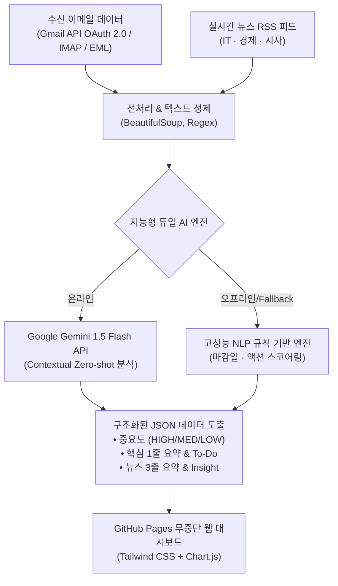

# ⚡ SmartMail & DailyBriefing AI
> **AI 기반 수신 메일 맥락 분석 및 IT·경제·시사 3대 핵심 뉴스 3줄 요약 시스템**  
> *일상의 정보 탐색 비효율을 해결하기 위한 실무형 AI 자동화 파이프라인*

[-success.svg?logo=github&logoColor=white)](https://github.com)
[](https://www.python.org/)
[](#)
[](LICENSE)

---

## 🌐 라이브 데모 (24/7 무중단 GitHub Pages)

> 💡 **Streamlit의 슬립 모드(Sleep/Locking) 한계 극복:**  
> 기존 무료 호스팅 플랫폼(Streamlit Community Cloud 등)은 방문자가 없을 때 서버가 절전 모드로 잠기는(Sleep) 치명적인 단점이 있어 평가자가 열람할 때 로딩 지연이 발생합니다.  
> 본 프로젝트는 **GitHub Pages 기반의 정적 웹 아키텍처**로 구현되어 **24시간 365일 지연 없이 즉시 열람**할 수 있습니다.

* **GitHub Pages 배포 주소:** `https://jeongseonghun054.github.io/Mail_Classification_Project/`
* **로컬 즉시 실행:** 브라우저에서 `index.html` 파일을 더블 클릭하면 별도의 서버 기동 없이도 로컬에서 100% 동작합니다.

---

## 📖 프로젝트 기획 배경 및 문제 정의 (Background & Overview)

> "수신함에 쌓이는 광고와 단순 안내 속에서 중요한 메일을 가려내는 일은 매일 반복적인 시간 소모를 일으켰습니다. 또한 최신 흐름을 놓치지 않기 위해 시사, 경제, IT 뉴스를 포털마다 일일이 검색해 정독하는 과정 역시 인지적 피로를 가중시켰습니다. 이러한 정보 선별 작업을 사람이 매번 수작업으로 처리하는 것은 비효율적이며, 텍스트의 맥락을 이해하는 AI를 적용하면 정보 처리 시간을 크게 줄일 수 있다고 판단했습니다.  
> 이를 개선하기 위해 AI를 활용한 개인 맞춤형 정보 자동 분류 및 요약 시스템을 직접 설계하고 구현했습니다. 수신된 메일의 텍스트 내용을 파악해 중요도를 판별하고 자동으로 분류하는 기능을 구축했습니다. 이와 함께 매일 발행되는 시사, 경제, IT 분야의 주요 기사를 자동으로 수집하고, 긴 본문에서 핵심 내용만 간추려 정리해주는 요약 기능을 연동했습니다."

---

## 💡 핵심 구현 기능 (Key Capabilities)

1. **지능형 메일 중요도 판별 & 자동 분류:** 메일 본문의 마감 시한, 결재/검토 등 액션 아이템 유무를 분석하여 중요도(HIGH/MEDIUM/LOW)를 판별하고, 긴급 업무/일반 업무/단순 공지/광고 4대 카테고리로 자동 분리 격리합니다. 영문 메일은 자동 한국어 번역 및 4단계 일목요연 구조화(핵심 목적, 3대 요약 포인트, To-Do, 시한)를 적용합니다.
2. **시사·경제·IT 3대 도메인 뉴스 3줄 요약:** 언론사 실시간 RSS 피드로부터 최신 기사를 수집하고, BeautifulSoup 전처리를 통해 불필요한 노이즈를 제거한 뒤 기사당 3줄 핵심 요약과 1줄 실무 시사점(Takeaway Insight)을 자동 생성합니다.
3. **아침 3분 모닝 브리핑 대시보드:** 출근 즉시 당일의 긴급 대응 메일과 3대 분야 핵심 뉴스를 단일 화면에서 3분 만에 파악할 수 있는 인터랙티브 대시보드를 제공합니다.

> 📄 **상세 기획 및 아키텍처:** 본 프로젝트의 상세 기획 배경, 트러블슈팅, 정량 성과는 [PORTFOLIO.md](./PORTFOLIO.md) 또는 웹 대시보드의 **'프로젝트 소개 & 기획 배경'** 탭에서 확인하실 수 있습니다.

---

## 🛠️ 시스템 아키텍처 (Architecture)



---

## ✨ 주요 기능 (Key Features)

### 1. 🌅 오늘의 모닝 브리핑 (Daily Briefing)
* **긴급 업무 알림 (High Priority):** 오늘 마감 시한이 있거나 결재/검토가 필요한 긴급 메일을 상단에 우선 배치.
* **3대 도메인 뉴스 요약:** IT/테크, 경제/금융, 시사/종합 분야별 최신 기사 3줄 요약 및 실무 인사이트 제공.

### 2. 📧 스마트 수신함 (Smart Inbox)
* 4대 카테고리(`긴급 업무`, `일반 업무`, `단순 공지`, `광고/홍보`) 및 3단계 중요도(`HIGH`, `MEDIUM`, `LOW`) 자동 분류.
* 실시간 키워드 검색 및 카테고리 필터링.
* 메일 카드 클릭 시 상세 본문, 1줄 요약, AI 분류 근거, 체크 가능한 **To-Do 액션 아이템** 모달 제공.

### 3. 📰 실시간 뉴스 요약 피드 (News Digest)
* IT/테크, 경제/금융, 시사/종합 탭 전환.
* 10초 만에 핵심을 파악할 수 있는 밀도 높은 3줄 요약.

### 4. 📊 업무 효율성 분석 대시보드 (Productivity Analytics)
* 메일 확인 시간 80% 절감 (35분 ➔ 7분) 및 뉴스 탐색 시간 80% 절감 (40분 ➔ 8분).
* 도입 전/후 비교 인터랙티브 바 차트 및 카테고리 도넛 차트 시각화.

### 5. 📄 SK AIGEN 포트폴리오 전문 뷰어 & PDF 원클릭 저장
* 서류 및 면접 전형에 즉시 제출할 수 있는 상세 기술서가 탭으로 내장되어 있으며, 원클릭 PDF 저장을 지원합니다.

---

## 🚀 GitHub Pages 배포 방법 (초간단 1분 세팅)

1. 본 레포지토리를 GitHub에 푸시합니다:
   ```bash
   git add .
   git commit -m "feat: Deploy SmartMail & DailyBriefing AI on GitHub Pages"
   git remote add origin https://github.com/JeongSeongHun054/Mail_Classification_Project.git
   git branch -M main
   git push -u origin main
   ```
2. GitHub 저장소의 **[Settings] ➔ [Pages]** 탭으로 이동합니다.
3. **Build and deployment** 항목의 Source를 **Deploy from a branch**로 선택합니다.
4. Branch를 `main`, 폴더를 `/ (root)`로 선택하고 **Save**를 누릅니다.
5. 약 1분 후 `https://jeongseonghun054.github.io/Mail_Classification_Project/` 링크로 전 세계 어디서나 24시간 무중단 접속이 가능합니다!

---

## 📂 디렉터리 구조 (Directory Structure)

```
Mail Classification Project/
├── index.html             # GitHub Pages 배포용 반응형 웹 대시보드 (SPA - Gmail 연동 및 EML 파서 포함)
├── gmail_fetcher.py       # Google OAuth 2.0 기반 실제 Gmail 수신함 연동 및 자동 분류기
├── config.py              # 카테고리, RSS 피드 URL, 시스템 환경 설정
├── mail_classifier.py     # 파이썬 기반 이메일 맥락 분석 및 중요도 판별 모듈
├── news_summarizer.py     # 파이썬 기반 RSS 수집 및 3줄 요약 모듈
├── sample_emails.json     # 현실적인 테스트 및 시연용 이메일 데이터셋
├── test_pipeline.py       # 단위 테스트 (5개 테스트 케이스 통과 검증)
├── requirements.txt       # 의존성 패키지 목록
├── README.md              # 깃허브 저장소 공식 문서
└── PORTFOLIO.md           # SK AIGEN 제출용 상세 포트폴리오 기술서
```
